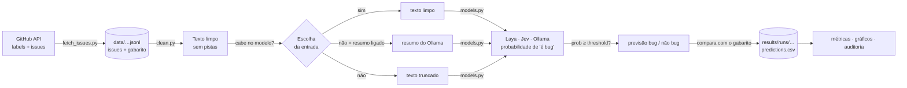

# SAD · PoC de triagem de issues com modelos de decisão

Projeto da disciplina **IF1006 (Transformação Digital com IA, CIn-UFPE)**.

O **SAD** avalia issues de repositórios open source do GitHub e decide se cada uma é bug e qual a
severidade. A arquitetura é **dual**:

- **Sistema 1:** um *modelo de decisão* avalia **toda** issue. Ele não gera texto: recebe um texto e
  uma pergunta tipada, e devolve probabilidades. É rápido e barato.
- **Sistema 2:** um LLM comum, chamado só para as issues críticas.

**Esta PoC testa o Sistema 1.** Para cada issue, ela faz uma única pergunta do tipo *Noul* (sim/não):

> *"Does this issue describe a defect (bug) in the software's behavior?"*

Depois compara a resposta com o rótulo que os mantenedores do projeto deram à issue (bug ou não bug)
e mede **quanto o modelo acerta** e **quanto tempo ele leva**.

---

## Sumário

1. [Os três modelos comparados](#1-os-três-modelos-comparados)
2. [Como funciona, em uma figura](#2-como-funciona-em-uma-figura)
3. [Instalação](#3-instalação)
4. [Como rodar: interface gráfica](#4-como-rodar-interface-gráfica)
5. [Como rodar: terminal](#5-como-rodar-terminal)
6. [A interface campo por campo](#6-a-interface-campo-por-campo)
7. [A lógica completa, etapa por etapa](#7-a-lógica-completa-etapa-por-etapa)
8. [A limpeza do texto, regra por regra](#8-a-limpeza-do-texto-regra-por-regra)
9. [Métricas: o que cada número significa](#9-métricas-o-que-cada-número-significa)
10. [O que fica salvo (arquivos de saída)](#10-o-que-fica-salvo-arquivos-de-saída)
11. [Auditoria](#11-auditoria)
12. [Configuração (`.env`)](#12-configuração-env)
13. [Como ligar o Jev](#13-como-ligar-o-jev)
14. [Usar outro repositório](#14-usar-outro-repositório)
15. [Estrutura de arquivos](#15-estrutura-de-arquivos)
16. [Limitações conhecidas](#16-limitações-conhecidas)
17. [Solução de problemas](#17-solução-de-problemas)
18. [Git e segurança](#18-git-e-segurança)

---

## 1. Os três modelos comparados

| Nome | O que é | Onde roda | O que devolve | Contexto (quanto texto lê) |
|---|---|---|---|---|
| **`laya`** | [Laya](https://huggingface.co/convaiinnovations/laya) 0.4.12, checkpoint **em inglês** (ModernBERT-large, 421M parâmetros). Modelo de decisão open source. | **Local**, na GPU do Mac (MPS) | Probabilidade de 0 a 1 | **512 tokens** (≈ 489 para a issue, descontando a pergunta) |
| **`jev`** | Jev, da TypeSafe AI, via API `POST /v1/systemone`. Modelo de decisão comercial. | **Nuvem** (precisa de chave) | Probabilidade de 0 a 1 | 32k tokens por pergunta |
| **`ollama`** | `qwen2.5:7b`, um LLM comum, respondendo `{"is_bug": true/false}`. É o **baseline "só LLM"** para comparar. | **Local**, via Ollama | 1,0 ou 0,0 (sem meio-termo) | 16k tokens (`OLLAMA_NUM_CTX`) |

**Laya e Jev** são o tipo de modelo que o Sistema 1 usaria. **O Ollama** serve de referência:
mostra quanto um LLM genérico acerta na mesma tarefa, e a que custo de tempo.

O Ollama também tem um **segundo papel, opcional**: gerar *resumos* das issues longas demais para a
Laya (ver [7.3](#73-escolha-da-entrada-de-cada-modelo)).

---

## 2. Como funciona, em uma figura



Em palavras:

1. **Baixa** issues fechadas que os mantenedores rotularam como bug ou não bug. O rótulo vira o
   **gabarito** e nunca é mostrado ao modelo.
2. **Limpa** o texto, tirando tudo que entregaria a resposta sem o modelo precisar entender a issue
   (comandos `/kind bug`, cabeçalhos de formulário, seções que só existem no template de bug…).
3. **Pergunta** a cada modelo, com o título e o corpo limpo: *"isso descreve um bug?"*
4. **Compara** a resposta com o gabarito e calcula acurácia, precisão, recall, F1 e tempo de resposta.

---

## 3. Instalação

### Pré-requisitos

| O quê | Para quê | Como conseguir |
|---|---|---|
| **Python 3.10 ou mais novo** | Rodar o projeto (a Laya exige ≥ 3.10) | `python3 --version` |
| **Ollama** + modelo `qwen2.5:7b` (~4,7 GB) | Baseline e resumos | App em [ollama.com](https://ollama.com) ou `brew install ollama` |
| **Acesso ao GitHub** (opcional, mas recomendado) | Baixar issues sem o limite de 60 requisições/hora | `gh auth login` **ou** `GITHUB_TOKEN` no `.env` |
| **Chave da TypeSafe** (opcional) | Usar o Jev | [console.typesafe.ai/keys](https://console.typesafe.ai/keys) |

Máquina usada nos testes: MacBook Pro M1, 16 GB de RAM. A Laya usa a GPU do Mac (MPS) quando existe;
sem ela, roda na CPU, mais devagar.

### Passo a passo

```bash
cd poc-decisao
python3 -m venv .venv                       # cria o ambiente Python isolado do projeto
source .venv/bin/activate                   # ativa (o prompt passa a mostrar "(.venv)")
pip install -r requirements.txt             # instala laya, streamlit, scikit-learn…
cp .env.example .env                        # cria seu arquivo de configuração (edite se quiser)
ollama pull qwen2.5:7b                      # baixa o LLM do baseline (uma vez só)
```

- **Na primeira execução, a Laya baixa os pesos** do Hugging Face (~1,7 GB, guardados em
  `~/.cache/huggingface`). Nas próximas, carrega do disco em poucos segundos.
- O **Ollama precisa estar aberto** (o app na barra de menus, ou `ollama serve` num terminal).
- Sem ativar o ambiente, chame os programas pelo caminho: `.venv/bin/python …` e
  `.venv/bin/streamlit …`.

---

## 4. Como rodar: interface gráfica

```bash
cd poc-decisao
source .venv/bin/activate
streamlit run app.py
```

Abra **http://localhost:8501** no navegador. Um uso típico:

1. **Barra lateral → 1 · Dados:** digite o repositório (ex.: `apache/airflow`), confira as labels
   sugeridas, escolha quantas issues por classe e clique em **⬇️ Baixar issues**.
2. **Aba 🔎 Issues:** abra algumas issues e confira a coluna **Limpo**. É exatamente o texto que o
   modelo vai ver; veja se nada ali entrega a resposta.
3. **Barra lateral → 2 · Avaliação:** escolha os modelos e clique em **▶️ Rodar avaliação**. O
   progresso aparece no topo da página.
4. **Aba 📊 Resultados:** quando terminar, a página se atualiza sozinha e mostra as métricas.
5. **Aba 📈 Comparar execuções:** compare com execuções anteriores.

Para parar o servidor, use `Ctrl+C` no terminal. **Depois de editar o código, reinicie** o
`streamlit run`: o recarregamento automático está desligado (ver [16](#16-limitações-conhecidas)).

---

## 5. Como rodar: terminal

Os mesmos passos, sem interface. Com o ambiente ativado (`source .venv/bin/activate`):

```bash
# 1. Ver as labels do repositório (para decidir quais são bug e quais não são)
python fetch_issues.py --repo apache/airflow --list-labels

# 2. Baixar 10 bug + 10 não bug
python fetch_issues.py --repo apache/airflow --limit 10 \
    --bug-labels kind:bug --not-bug-labels kind:feature,kind:documentation \
    --exclude-labels kind:task,kind:meta --out data/datasets/apache__airflow.jsonl

# 3. Ver como a limpeza transforma algumas issues (antes / depois / resumo)
python clean.py --show 4 --summarize

# 4. Avaliar
python run_eval.py --models laya,jev,ollama --summarize --data data/datasets/apache__airflow.jsonl

# 5. Auditar
python audit.py
```

Gravar o arquivo em `data/datasets/<owner>__<repo>.jsonl` (como no passo 2) faz a interface
reconhecer o mesmo conjunto.

### Opções de cada script

**`fetch_issues.py`**: baixa as issues.

| Opção | Padrão | O que faz |
|---|---|---|
| `--repo owner/nome` | `kubernetes/kubernetes` | Repositório de onde baixar |
| `--list-labels` | — | Só lista as labels do repositório e sai |
| `--limit N` | `50` | Quantas issues **por classe** (N bug + N não bug) |
| `--bug-labels` | `kind/bug,kind/regression` | Labels que contam como **bug** (separadas por vírgula; qualquer uma basta) |
| `--not-bug-labels` | `kind/feature,kind/support,kind/documentation` | Labels que contam como **não bug** |
| `--exclude-labels` | `kind/flake,kind/failing-test` | Labels **ambíguas**: issues com elas ficam de fora dos dois lados |
| `--since` | `2026-05-01,2026-03-01` | Janelas de data de criação, em ordem de preferência (ver [7.1](#71-download-fetch_issuespy)) |
| `--out caminho` | `data/issues.jsonl` | Onde gravar |
| `--force` | — | Baixa de novo mesmo se o arquivo já existir |

**`clean.py`**: mostra a limpeza (não altera nada).

| Opção | O que faz |
|---|---|
| `--show N` | Mostra N issues, alternando bug e não bug (padrão 2) |
| `--number 74703` | Mostra uma issue específica (pode repetir a opção) |
| `--summarize` | Também gera e mostra o resumo do Ollama |

**`run_eval.py`**: avalia e imprime as métricas.

| Opção | Padrão | O que faz |
|---|---|---|
| `--models laya,jev,ollama` | os disponíveis | Quais modelos rodar. O Jev só entra se houver chave; o Ollama, se estiver aberto |
| `--data caminho` | `data/issues.jsonl` | Arquivo de issues a avaliar |
| `--threshold 0.5` | `0.5` | Probabilidade a partir da qual a resposta vira "bug" |
| `--summarize` | desligado | Usa o resumo do Ollama quando a issue não cabe no modelo (na prática, só na Laya) |
| `--limit N` | todas | Avalia só N issues, alternando bug e não bug para manter o equilíbrio |

**`audit.py`**: confere tudo (ver [11](#11-auditoria)).

| Opção | O que faz |
|---|---|
| *(sem opções)* | Checagens offline em todas as execuções salvas |
| `--live RUN_ID` | Também pergunta de novo aos modelos e mede a latência de cada um sozinho |
| `--n N` | Quantas issues usar no `--live` (padrão 6) |

---

## 6. A interface campo por campo

### Barra lateral → **1 · Dados**

| Campo | O que é | Detalhes |
|---|---|---|
| **Repositório (owner/nome)** | O repositório do GitHub a usar | Ao digitar, a interface busca as labels dele na API do GitHub (cache de 10 min). Nenhuma issue é baixada ainda. |
| **Labels de bug** | Labels que marcam uma issue como **bug** | Vem com uma **sugestão automática** baseada só no *nome* das labels: com o prefixo `kind/`, considera só essas; nomes com "bug" ou "regression" viram bug. **Confira sempre.** No Kubernetes, usa a lista validada (`kind/bug`, `kind/regression`). |
| **Labels de não bug** | Labels que marcam **não bug** | Sugestão: nomes com "feature", "enhancement", "question", "support" ou "doc". |
| **Labels ambíguas (excluir)** | Labels de casos de fronteira | Issues com qualquer uma delas **saem dos dois lados**. Sugestão: nomes com "flake" ou "failing test" (teste instável é bug do teste ou do código?). |
| **Issues por classe** | Quantas issues de cada classe baixar | 5 a 500. Ex.: 50 → 50 bug + 50 não bug. |
| **Criadas a partir de (janelas, em ordem)** | Datas mínimas de criação | Ex.: `2026-05-01,2026-03-01`. Tenta primeiro só issues desde maio; se faltar, completa com as de março a maio. Issues recentes reduzem a chance de o modelo tê-las visto no treino. |
| *(caixa verde)* | O conjunto já salvo para esse repositório | Quantas issues de cada classe e o intervalo de datas. |
| **⬇️ Baixar issues** / **de novo** | Baixa e salva o conjunto | Fica desabilitado sem labels de bug e de não bug. "De novo" substitui o conjunto anterior. |

### Barra lateral → **2 · Avaliação**

| Campo | O que é | Detalhes |
|---|---|---|
| **Modelos** | Quais modelos avaliar | `laya`, `ollama` e, se houver `TYPESAFE_API_KEY` no `.env`, `jev`. Eles rodam **um de cada vez** (ver [7.5](#75-execução-e-medição-de-tempo)). |
| **Modelo do Ollama** | Qual LLM local usar no baseline | Lista os modelos instalados no Ollama. Padrão `qwen2.5:7b`. |
| **Pergunta (Noul)** | A pergunta feita a cada issue | Editável. Fica salva na execução, para saber depois o que foi perguntado. |
| **Threshold** | Corte de probabilidade | Probabilidade ≥ threshold → "bug". Padrão 0,5. Não afeta o Ollama, que só devolve 0 ou 1. |
| **Usar resumo quando não couber no contexto (Laya)** | Liga a [camada 2 da limpeza](#82-camada-2-resumo-pelo-ollama-opcional) | Issue maior que o contexto da Laya → ela recebe um resumo do Ollama em vez do texto cortado. |
| **Limitar a N issues (0 = todas)** | Avaliar só uma parte | Útil para testes rápidos. Mantém o equilíbrio bug/não bug. |
| **▶️ Rodar avaliação** | Começa a avaliação | Desabilitado enquanto outra avaliação roda. |

### Painel de execução (topo da página, durante a avaliação)

- **Barra de progresso:** chamadas feitas / total (issues × modelos), com o modelo e a issue atuais.
- **Duas tabelas ao vivo:** métricas parciais por modelo e as últimas respostas.
- **⏹ Parar:** interrompe; o que já rodou fica salvo e marcado como "parada".
- A avaliação roda **em segundo plano**: dá para navegar pelas abas e mexer nos controles sem
  interrompê-la. Quando termina, a página se atualiza sozinha.

### Aba **📊 Resultados**

| Elemento | O que mostra |
|---|---|
| **Execução** | Qual execução salva analisar. O nome traz data-hora, repositório, modelos, nº de issues, se usou resumo e o status ("em andamento", "parada", "com erro", "incompleta"). |
| **Threshold para análise** | **Recalcula tudo com outro corte, sem chamar os modelos de novo** (as probabilidades já estão salvas). Serve para ver o efeito do threshold. Não muda o arquivo salvo. |
| **Cartões por modelo** | Acurácia, F1, precisão, recall, latência P50 e P90. Embaixo: AUC (só Laya/Jev), respostas inválidas, e quantas issues foram truncadas ou usaram resumo. |
| **Tabela de resumo** | Os mesmos números, lado a lado. |
| **Efetividade** | Barras de acurácia, precisão, recall e F1 por modelo. |
| **Latência por chamada** | Boxplot em escala log: a linha do meio é a mediana, a caixa vai do 1º ao 3º quartil e as hastes, do mínimo ao máximo. |
| **Matriz de confusão** | Uma por modelo: linhas = rótulo real, colunas = previsão. |
| **Métricas × threshold** | Como acurácia, precisão, recall e F1 mudam com o corte (só Laya/Jev). A linha cinza é o threshold atual. |
| **Distribuição das probabilidades** | Histograma de P(bug) separado por rótulo real. Bom sinal: bugs à direita, não bugs à esquerda. |
| **Erros com maior confiança** | Os erros em que o modelo estava mais seguro, com link para a issue. **Leia estes primeiro:** às vezes o erro é do rótulo, não do modelo. |
| **Todas as previsões** | Tabela completa com filtros (por modelo; todas / acertos / erros) e o botão **Baixar CSV**. |

### Aba **📈 Comparar execuções**

Gráfico de acurácia por execução e modelo, e uma tabela com todas as execuções salvas: repositório,
uso de resumo, nº de issues, acurácia, F1, precisão, recall, AUC, P50 e status.

### Aba **🔎 Issues**

| Elemento | O que faz |
|---|---|
| **Buscar no título** / **Classe** | Filtram a tabela do conjunto baixado. |
| **Abrir issue** | Mostra a issue escolhida: link, rótulo real e labels. |
| **Original** × **Limpo** | O texto bruto do GitHub ao lado do **texto exato que o modelo recebe**. É o melhor lugar para caçar pistas que a limpeza deixou passar. |
| **📝 Gerar/mostrar resumo** | Gera (ou mostra do cache) o resumo do Ollama dessa issue. |
| **❓ Perguntar agora** | Faz a pergunta da barra lateral aos modelos selecionados, só para essa issue, na hora. |
| **Respostas desta issue nas execuções salvas** | O que cada modelo respondeu para essa issue em cada execução. |

---

## 7. A lógica completa, etapa por etapa

### 7.1 Download (`fetch_issues.py`)

1. **Autenticação:** usa `GITHUB_TOKEN` do `.env`; se não houver, pega o token do `gh` CLI
   (`gh auth token`). Com token, o limite é de 5.000 requisições/hora; sem, 60.
2. **Labels:** `GET /repos/{owner}/{repo}/labels`, de 100 em 100. Antes de baixar, confere se as
   labels escolhidas existem; se alguma não existir, para com erro.
3. **Busca:** usa a **Search API** (`GET /search/issues`), uma busca para cada classe:
   ```
   repo:apache/airflow is:issue is:closed label:kind:feature,kind:documentation created:2026-05-01..*
   ```
   A vírgula entre labels significa "qualquer uma". O resultado vem **das mais novas para as mais
   antigas**.
4. **Filtros aplicados a cada resultado:**
   - **Pull requests saem.** A API de issues também devolve PRs.
   - **Conflito sai:** uma issue "bug" que também tenha label de não bug, ou label ambígua, é
     descartada (e vice-versa).
   - **Só issues fechadas**, porque o rótulo já passou pela revisão dos mantenedores.
5. **Janelas de data:** se a primeira janela (ex.: desde maio) não tiver issues suficientes, a
   seguinte (ex.: de março a maio) completa. Assim o conjunto fica o mais recente possível.
6. **Gravação:** um arquivo JSONL (uma issue por linha) com `number`, `title`, `body`, `labels`,
   `created_at`, `url` e **`gold`** (`bug` ou `not_bug`, o gabarito).
7. **Cache:** se o arquivo já existe, não baixa de novo (`--force` ou "Baixar de novo" refazem).

A Search API devolve no máximo 1.000 resultados por busca, o que sobra para até 500 por classe.

### 7.2 Limpeza

O título e o corpo passam por regras de regex (camada 1, sempre) e, opcionalmente, por um resumo
(camada 2). Detalhes na [seção 8](#8-a-limpeza-do-texto-regra-por-regra).

**As labels nunca chegam ao modelo:** ele recebe só `título + corpo limpo`. A limpeza existe para
tirar pistas *de dentro do texto*.

### 7.3 Escolha da entrada de cada modelo

Antes de perguntar, cada modelo recebe uma de três entradas (fica registrada na coluna `input`):

| Situação | Entrada | Coluna `input` |
|---|---|---|
| O texto limpo cabe no contexto do modelo | O texto limpo inteiro | `clean` |
| Não cabe, e o resumo está ligado | O resumo factual gerado pelo Ollama | `summary` |
| Não cabe, e o resumo está desligado | O texto inteiro, **cortado pelo próprio modelo** (a Laya lê só o início) | `truncated` |

Quanto cabe em cada modelo:
- **Laya:** 512 tokens − pergunta − 8 de margem ≈ **489 tokens** de issue, contados com o próprio
  tokenizer da Laya. Muitas issues passam disso: no Kubernetes, 41 de 99, mesmo depois da limpeza.
- **Jev:** ~30.000 tokens (estimativa: caracteres ÷ 4). Na prática, nunca corta.
- **Ollama:** nunca resumido. O prompt usa contexto de 16k tokens (`OLLAMA_NUM_CTX`); o padrão do
  Ollama (4.096) dava erro 500 em issues com logs longos.

### 7.4 A pergunta a cada modelo (`models.py`)

Todos implementam a mesma interface: `ask_noul(texto, pergunta) → probabilidade de "sim"`.

| Modelo | Como é chamado | Resposta | Determinístico? |
|---|---|---|---|
| **Laya** | `laya.load("convaiinnovations/laya")` uma vez (checkpoint em inglês, sem o roteador da biblioteca, que poderia trocar de modelo); depois `agent.predict(texto, {"q": {"type": "noul", "instructions": pergunta}})` | `answers.q.noul` (0–1) | Sim: mesma entrada, mesma probabilidade |
| **Jev** | `POST {TYPESAFE_BASE_URL}/v1/systemone` com `model`, `state` (o texto) e `questions` | `answers.is_bug.noul` (0–1) | Quase: varia até ~0,03 entre chamadas, sem mudar a previsão |
| **Ollama** | `POST /api/chat` com `format: "json"`, `temperature: 0` e o prompt *"Answer only with {"is_bug": true} or {"is_bug": false}"* | `true` → 1,0; `false` → 0,0 | Sim |

**Não existe fallback.** Nenhum modelo responde no lugar de outro:
- **Ollama:** JSON inválido ou erro HTTP vira **`invalid`**, que conta como **erro** nas métricas.
- **Jev:** com 429/529 (limite ou sobrecarga), tenta **no próprio Jev** até 5 vezes, respeitando
  `retry-after`. Outro erro para a execução (status "com erro").
- **Procedência:** cada resposta grava `served_by`, quem de fato respondeu segundo o servidor. A
  auditoria confere isso.

### 7.5 Execução e medição de tempo

A avaliação (`evaluate()` em `run_eval.py`, usada pelo terminal e pela interface) faz, **para cada
modelo, um de cada vez**:

1. **Prepara todas as entradas** daquele modelo (texto limpo, resumo ou truncado). Os resumos são
   gerados aqui, *antes* de cronometrar.
2. **Ollama:** descarrega o modelo da memória, o que **zera o cache de prompt**.
3. **Aquecimento:** faz uma chamada de teste, fora da medição. A 1ª chamada da Laya na GPU e a
   carga do Ollama são lentas e não representam o uso normal.
4. **Pergunta issue por issue**, cronometrando **só a chamada ao modelo**.

Por que assim (problemas que a [auditoria](#11-auditoria) encontrou e corrigiu):
- **Um modelo de cada vez:** Laya e Ollama alternados disputavam a GPU do M1. A Laya aparecia com
  P90 de ~760 ms quando o real é ~100 ms.
- **Cache zerado:** o Ollama guarda prompts já vistos. Reavaliar as mesmas issues o deixava de 3 a
  13 vezes mais rápido do que numa issue nova, o que é irreal em produção.

**O que `latency_ms` inclui:** tokenização + inferência; no Jev, também a ida e volta pela internet.
**O que não inclui:** limpar o texto, gerar o resumo e carregar o modelo.

Valores de referência (20 issues do Airflow, medição limpa):

| | Laya | Jev | Ollama qwen2.5:7b |
|---|---|---|---|
| P50 / P90 | **68 / 98 ms** | 221 / 237 ms (~40 ms no servidor, o resto é rede) | 1.080 / 2.982 ms |

### 7.6 Previsão

- **Laya e Jev:** probabilidade **≥ threshold** → `bug`; abaixo → `not_bug`.
- **Ollama:** 1,0 → `bug`; 0,0 → `not_bug`; resposta inválida → `invalid` (conta como erro).

### 7.7 Comparação e métricas

Cada previsão é comparada com o `gold` e as métricas são calculadas por modelo (ver
[seção 9](#9-métricas-o-que-cada-número-significa)). Tudo é gravado em
`results/runs/<data-hora>/` (ver [seção 10](#10-o-que-fica-salvo-arquivos-de-saída)).

---

## 8. A limpeza do texto, regra por regra

**Objetivo:** o modelo precisa *entender* a issue para responder. Ele não pode achar a resposta numa
pista de formato. Toda regra abaixo existe porque uma pista real foi encontrada nos dados.

### 8.1 Camada 1: regex (sempre)

Aplicadas nesta ordem (`clean_body()` em `clean.py`):

| # | Regra | Exemplo do que sai | Por quê |
|---|---|---|---|
| 1 | **Comentários HTML** | `<!-- Please fill in the template -->` | Instruções do template; algumas citam `/kind bug`. |
| 2 | **Blocos de código são "guardados"** (trocados por marcadores) e encurtados para **10 linhas**, com `[... N more lines]` | Um log de 300 linhas vira 10 + aviso | Logs gastam o contexto da Laya. Guardar os blocos impede que as regras seguintes mexam no código (um `# comentário` não é cabeçalho). |
| 3 | **Comandos de bot** (linha inteira) | `/kind bug`, `/sig node`, `/priority important-soon`, `/triage accepted`, `/assign`, `/lgtm`… | Dizem o rótulo literalmente. |
| 4 | **Comandos de bot no meio da linha** | `... reproduzido. /kind bug` | Idem. |
| 5 | **Seções de formulário inteiras** (título e conteúdo) | Kubernetes: *Kubernetes version, Cloud provider, OS version, Install tools, Container runtime, Related plugins*. Airflow: *Under which category, Apache Airflow version, Operating System, Deployment, Provider(s), Helm Chart, Docker Image, Are you willing to submit PR, Code of Conduct, Related issues* | Só existem num dos templates (em geral, no de bug). No Kubernetes, `kubectl version` aparecia em **46% dos bugs e 2% dos não bugs**. |
| 6 | **Cabeçalhos de template conhecidos** | *What happened?*, *What did you expect to happen?*, *What would you like to be added?*, *Why is this needed?*, *Steps to reproduce*… | Cada um pertence a um tipo de formulário. |
| 7 | **Qualquer outro cabeçalho Markdown, inteiro** (o texto do título também; o conteúdo abaixo fica) | `### Use case/motivation`, `## Summary` | Títulos de formulário de repositórios que não conhecemos também entregariam a classe. |
| 8 | **Checkboxes** | `- [x] Yes I am willing to submit a PR!` | Texto de formulário. |
| 9 | **`_No response_`** | Campo opcional vazio | Ruído do formulário. |
| 10 | **Tags HTML** | `<details>`, `<summary>`, `<br>`… | Formatação. |
| 11 | **Imagens** → `[image]` | ``, `` | O modelo não lê imagem; a URL gasta tokens. |
| 12 | **Espaços normalizados** | Linhas em branco repetidas, espaços duplos | Economia de tokens. A indentação dentro do código é preservada. |
| 13 | **Blocos de código voltam** | — | Já encurtados no passo 2. |

**Título:** prefixos como `[Bug]`, `Feature:`, `(Regression)`, `Flaky test:` saem.

**Saída:** `título + "\n\n" + corpo_limpo`.

**O que a limpeza mantém de propósito:** o conteúdo escrito pela pessoa, mesmo quando traz sinal de
classe. Palavras como "regression", "would be nice", "crash" ou "propose" são *conteúdo legítimo*: é
assim que as pessoas descrevem bugs e pedidos. Tirá-las esconderia a própria issue.

**Como verificar:** na aba 🔎 Issues, compare **Original × Limpo**, ou rode
`python clean.py --number <issue>`.

### 8.2 Camada 2: resumo pelo Ollama (opcional)

Usada **só quando a issue não cabe no modelo** (na prática, a Laya) **e** o resumo está ligado.

- O `qwen2.5:7b` reescreve a issue em até ~120 palavras, só com fatos: o que a pessoa fez, o que
  esperava, o que aconteceu, o ambiente.
- O prompt **proíbe** classificar, inferir fatos e usar as palavras "bug", "defect" e
  "feature request", para o LLM não fazer o trabalho do modelo de decisão.
- **Cache** em `data/summaries.jsonl`, por issue + texto + prompt: se o prompt ou a limpeza mudarem,
  o resumo é refeito.

> ⚠️ **O resumo pode distorcer.** Na issue airflow#74712, o resumo transformou "a interface manda
> `dry_run=true` por engano" em "o usuário definiu `dry_run=true`". Com isso, o bug virou
> comportamento esperado e a Laya errou. Resumo é uma troca: cabe no contexto, mas pode perder ou
> inverter o sentido. Confira com o botão **📝 Gerar/mostrar resumo** ou `clean.py --summarize`.

---

## 9. Métricas: o que cada número significa

"Positivo" = **bug**. Usando a matriz de confusão:

|  | previu **bug** | previu **não bug** |
|---|---|---|
| **é bug** | **VP** (acerto) | **FN** (bug que passou batido) |
| **não é bug** | **FP** (alarme falso) | **VN** (acerto) |

| Métrica | Fórmula | Em palavras | Quando importa |
|---|---|---|---|
| **Acurácia** | (VP + VN) / total | Fração de respostas certas | Visão geral. Com classes equilibradas, 50% é o acaso. |
| **Precisão (bug)** | VP / (VP + FP) | Das issues chamadas de bug, quantas eram bug | Precisão baixa = muitos alarmes falsos. |
| **Recall (bug)** | VP / (VP + FN) | Dos bugs reais, quantos foram encontrados | Recall baixo = bugs passando sem triagem. |
| **F1 (bug)** | 2 · P · R / (P + R) | Equilíbrio entre precisão e recall | Um número só para a classe bug. |
| **AUC** | Probabilidade de um bug sorteado receber nota maior que um não bug sorteado | Qualidade da *ordem* das probabilidades, independente do threshold | 0,5 = acaso; 1,0 = perfeito. Só Laya/Jev (o Ollama só dá 0 ou 1). |
| **Latência P50** | Mediana do tempo por chamada | Metade das chamadas é mais rápida que isso | Tempo típico. |
| **Latência P90** | Percentil 90 | 90% das chamadas são mais rápidas que isso | A "cauda lenta", que pesa em produção. |
| **Inválidas** | — | Respostas do Ollama fora do formato | Contam como erro. |

**Para interpretar:**
- **Threshold:** subir o corte reduz alarmes falsos (precisão ↑) e deixa passar mais bugs
  (recall ↓). O gráfico *métricas × threshold* mostra essa troca. Escolher o melhor corte olhando o
  próprio conjunto de teste é otimista; calibre em outro conjunto.
- **Amostra pequena:** com 20 issues, cada erro vale 5 pontos de acurácia. Com ~100, diferenças de
  2–3 pontos entre modelos ainda são ruído.
- **O rótulo também erra:** numa revisão manual das 20 issues do Airflow, 4 eram ambíguas e 2 bugs
  eram o mesmo defeito (detalhes em `data/datasets/apache__airflow.review.json`). Leia os "erros com
  maior confiança" antes de culpar o modelo.

---

## 10. O que fica salvo (arquivos de saída)

### `results/runs/<data-hora>/`: uma pasta por execução

**`config.json`**: como a execução foi feita.

| Campo | Significado |
|---|---|
| `repo`, `dataset` | Repositório e arquivo de issues usados |
| `issues` | Quantas issues |
| `models`, `ollama_model` | Modelos avaliados e qual LLM do Ollama |
| `question`, `threshold`, `summarize` | A pergunta, o corte e se o resumo estava ligado |
| `started_at`, `finished_at` | Início e fim |
| `status` | `done`, `stopped` (parada), `error` ou `running` |

**`predictions.csv`**: uma linha por issue e modelo.

| Coluna | Significado |
|---|---|
| `number`, `title`, `url` | A issue |
| `gold` | Rótulo real (`bug` / `not_bug`) |
| `model` | Qual modelo respondeu (`laya`, `jev`, `ollama`) |
| `prob` | Probabilidade de "é bug" (Ollama: 0 ou 1; vazio se inválida) |
| `pred` | Previsão: `bug`, `not_bug` ou `invalid` |
| `latency_ms` | Tempo da chamada ao modelo (ver [7.5](#75-execução-e-medição-de-tempo)) |
| `input` | O que o modelo recebeu: `clean`, `summary` ou `truncated` |
| `served_by` | **Quem de fato respondeu**, segundo o servidor: checkpoint@commit da Laya, versão do Jev (`jev-1.13.0`), modelo do Ollama |
| `request_id` | Id da requisição na TypeSafe (só Jev) |
| `server_ms` | Tempo gasto *dentro* do servidor (Jev: sem a rede; Ollama: tempo total do servidor) |
| `load_ms` | Tempo que o Ollama gastou carregando o modelo nessa chamada (deve ser ~0) |
| `cached_tokens`, `prompt_tokens` | Quantos tokens do prompt o Ollama reaproveitou do cache (~16% é normal: o cabeçalho fixo do prompt) |

### Outros arquivos

| Arquivo | Conteúdo |
|---|---|
| `results/predictions.csv` | A última execução **pelo terminal** (sobrescrito a cada vez) |
| `results/report_*.txt`, `results/predictions_*.csv` | Cópias de rodadas feitas pelo terminal |
| `data/issues.jsonl` | Conjunto baixado pelo terminal (padrão: Kubernetes) |
| `data/datasets/<owner>__<repo>.jsonl` | Um conjunto por repositório (usado pela interface) |
| `data/datasets/apache__airflow.review.json` | Revisão manual dos rótulos das 20 issues do Airflow |
| `data/summaries.jsonl` | Cache dos resumos do Ollama |

`data/` e `results/` não vão para o git: são regenerados pelos scripts.

---

## 11. Auditoria

```bash
python audit.py                           # offline: todas as execuções salvas
python audit.py --live <RUN_ID> --n 20    # + reprodução e benchmark de latência
```

O `RUN_ID` é o nome da pasta em `results/runs/` (ex.: `20261021-112612`). O script termina com
código 0 se não houver falhas (✅/⚠️) e 1 se houver alguma (❌).

**Offline** (não chama nenhum modelo), para cada execução:

| Checagem | O que garante |
|---|---|
| Estrutura | Uma linha por issue e modelo, sem duplicatas, todos os modelos com as mesmas issues |
| Gabarito | O `gold` salvo bate com o arquivo de issues baixado |
| Previsão | `pred` é exatamente `prob ≥ threshold` (e `invalid` só quando não há probabilidade) |
| Métricas | Acurácia, precisão, recall e F1 recalculados com **scikit-learn**; P50/P90 com **numpy**; os valores precisam ser idênticos |
| Procedência | `served_by` é o modelo pedido; o Jev tem um `request_id` único por chamada |
| Latência | Avisa se a execução rodou ao mesmo tempo que outra, se o Ollama respondeu do cache ou se houve recarga do modelo |

**Ao vivo** (`--live`):

| Checagem | O que garante |
|---|---|
| Reprodução | Pergunta de novo e compara com o salvo. Laya e Ollama: idênticos. Jev: diferença ≤ ~0,03, mesma previsão. |
| Laya sem rede | Bloqueia qualquer conexão durante as previsões da Laya; tem que dar zero tentativas. |
| Latência isolada | Mede cada modelo sozinho e compara com o que a execução registrou. |

Execuções anteriores a 21/10/2026 não têm as colunas de procedência, e nelas a latência da Laya está
inflada (eram feitas alternando modelos). As métricas de acerto delas estão corretas.

---

## 12. Configuração (`.env`)

Copie `.env.example` para `.env` e preencha o que precisar. **O `.env` nunca vai para o git.**

| Variável | Padrão | Para quê |
|---|---|---|
| `GITHUB_TOKEN` | *(vazio → usa o `gh`)* | Baixar issues sem o limite de 60 req/h |
| `TYPESAFE_API_KEY` | *(vazio → Jev desligado)* | Chave do Jev |
| `TYPESAFE_BASE_URL` | `https://api.typesafe.ai` | Endereço da API (ou de um gateway) |
| `TYPESAFE_MODEL` | `jev-latest` | Versão do Jev (`jev-latest`, `jev-preview` ou uma versão fixa, como `jev-1.13.0`) |
| `OLLAMA_MODEL` | `qwen2.5:7b` | LLM do baseline e dos resumos |
| `OLLAMA_URL` | `http://localhost:11434` | Endereço do Ollama |
| `OLLAMA_NUM_CTX` | `16384` | Contexto do Ollama em tokens (o padrão dele, 4.096, falha em issues longas) |

Depois de mudar o `.env`, **reinicie** o `streamlit run` para a interface ler os valores novos.

---

## 13. Como ligar o Jev

1. Crie uma chave em https://console.typesafe.ai/keys.
2. Cole no `.env`: `TYPESAFE_API_KEY=sua-chave`.
3. Teste com poucas issues: `python run_eval.py --models jev --limit 4`.
4. Reinicie a interface; o Jev aparece na lista de modelos.

Detalhes:
- O parser da resposta é `parse_jev_noul()` (`models.py`): lê `answers.<id>.noul`. Foi conferido numa
  chamada real (`jev-1.13.0`).
- 429/529 (limite ou sobrecarga) são tratados com novas tentativas e respeitam `retry-after`.
- **Custo:** US$ 0,042 por milhão de tokens de entrada. 100 issues custam bem menos de um centavo.
- **Gateways** (OpenRouter, Vercel, Cloudflare) não são descritos na documentação da TypeSafe. Para
  usar um, troque `TYPESAFE_BASE_URL`; se o formato de autenticação ou do corpo for outro, ajuste
  `JevModel.ask_noul`.
- **Privacidade:** o Jev recebe o texto das issues (públicas). Laya e Ollama não enviam nada para
  fora da máquina.

---

## 14. Usar outro repositório

Repositórios verificados com labels claras e volume suficiente (issues fechadas desde maio/2026):

| Repositório | Labels de bug | Labels de não bug |
|---|---|---|
| `apache/airflow` | `kind:bug` | `kind:feature`, `kind:documentation` (excluir `kind:task`, `kind:meta`) |
| `microsoft/vscode` | `bug` | `feature-request`, `*question` |
| `elastic/elasticsearch` | `>bug` | `>enhancement` |
| `grafana/grafana` | `type/bug` | `type/feature-request` |
| `kubernetes/kubernetes` | `kind/bug`, `kind/regression` | `kind/feature`, `kind/support`, `kind/documentation` |

**Checklist para um repositório novo:**
1. Liste as labels e escolha bug / não bug / ambíguas. Não confie cegamente na sugestão automática.
2. Baixe poucas issues (ex.: 10 por classe).
3. **Confira o texto limpo** de algumas issues de cada classe na aba 🔎 Issues. Se o template do
   repositório tiver seções que só aparecem numa classe (versão, ambiente, "use case"…), acrescente
   os nomes delas em `TEMPLATE_DROP_SECTION` (`clean.py`).
4. Só então baixe o conjunto completo e avalie.

---

## 15. Estrutura de arquivos

```
poc-decisao/
├── fetch_issues.py      Baixa labels e issues do GitHub → data/…jsonl              (seção 7.1)
├── clean.py             Limpeza por regex + resumo via Ollama                       (seção 8)
├── models.py            Laya, Jev e Ollama com a mesma interface ask_noul()        (seção 7.4)
├── run_eval.py          evaluate(), métricas e o relatório no terminal              (seções 7.5–7.7)
├── app.py               Interface gráfica (Streamlit)                               (seção 6)
├── audit.py             Auditoria offline e ao vivo                                 (seção 11)
├── README.md            Este manual
├── RESULTADOS.md        Números e conclusões das avaliações
├── requirements.txt     Pacotes Python com versões fixas
├── .env.example         Modelo de configuração, sem segredos                        (seção 12)
├── .env                 Sua configuração e chaves — NÃO vai para o git
├── .gitignore           O que o git ignora (.env, .venv, data, results)
├── .streamlit/config.toml  Porta 8501 e recarregamento automático desligado
├── .venv/               Ambiente Python do projeto (não editar)
├── data/                Entrada: issues baixadas, revisão manual, cache de resumos  (seção 10)
└── results/             Saída: uma pasta por execução, com config e predições       (seção 10)
```

---

## 16. Limitações conhecidas

- **Contexto da Laya:** 512 tokens. Issues longas são cortadas ou resumidas, e as duas opções perdem
  informação.
- **Resumo pode distorcer** (ver [8.2](#82-camada-2-resumo-pelo-ollama-opcional)).
- **Rótulos com ruído:** "feature" que descreve defeito, "bug" que é falha de design, duplicatas.
- **Contaminação de treino:** os modelos podem ter visto issues antigas. Por isso o padrão é usar
  issues recentes, mas não há garantia.
- **Templates de outros repositórios:** a limpeza conhece os do Kubernetes e do Airflow; outros
  precisam ser conferidos (ver [14](#14-usar-outro-repositório)).
- **Jev não é 100% determinístico:** varia até ~0,03 na probabilidade.
- **GPU compartilhada:** rodar duas avaliações ao mesmo tempo (ex.: terminal e interface) infla as
  latências locais. A auditoria avisa quando isso acontece.
- **Recarregamento da interface desligado** (`.streamlit/config.toml`): o vigia de arquivos do
  Streamlit reiniciava a página no meio das avaliações. Depois de editar o código, reinicie.

---

## 17. Solução de problemas

| Sintoma | Causa provável | Solução |
|---|---|---|
| "Ollama não está respondendo" | O Ollama está fechado | Abra o app Ollama ou rode `ollama serve` |
| Erro 500 do Ollama em issues grandes | Contexto pequeno demais | Aumente `OLLAMA_NUM_CTX` no `.env` |
| O Jev não aparece na interface | O `.env` mudou depois de abrir a interface | Reinicie o `streamlit run` |
| `Jev HTTP 401` | Chave inválida ou ausente | Confira `TYPESAFE_API_KEY` |
| "Rate limit atingido" no download | Sem token do GitHub | `gh auth login` ou `GITHUB_TOKEN` no `.env` |
| "Labels inexistentes" | Nome de label errado | `python fetch_issues.py --repo … --list-labels` |
| Poucas issues baixadas | A janela de data tem poucas issues | Acrescente uma data mais antiga em "Criadas a partir de" |
| Porta 8501 ocupada | Outra interface já está aberta | `streamlit run app.py --server.port 8502` |
| A interface não mostra uma mudança no código | Recarregamento desligado | `Ctrl+C` e `streamlit run app.py` de novo |
| Latência estranha | Duas avaliações ao mesmo tempo, ou cache do Ollama | `python audit.py` mostra a causa |
| `git: not a git repository` | O terminal está na pasta de cima | `cd poc-decisao` antes do comando |

---

## 18. Git e segurança

- **O `.gitignore` deixa de fora:** `.env` (e variações, exceto `.env.example`), `.venv/`, `data/`,
  `results/` e arquivos do sistema.
- **Trava de pre-commit** (`.git/hooks/pre-commit`, local): bloqueia o commit se entrar um `.env`,
  o valor de alguma chave definida no `.env` ou algo com cara de token do GitHub.
- **Repositório remoto:** `CBdGM/sad-poc-decisao` (**privado**).
- **Antes de tornar público**, lembre que o e-mail do autor fica gravado em cada commit; use o
  e-mail "noreply" do GitHub se preferir escondê-lo.

```bash
git status                      # o que mudou
git diff --cached               # o que vai entrar no próximo commit
git commit -m "mensagem"        # a trava roda aqui
git push -u origin main         # envia para o GitHub (só depois do primeiro commit)
```
